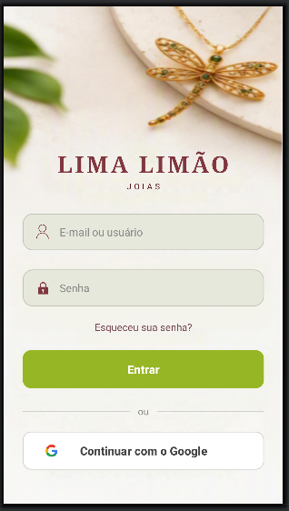
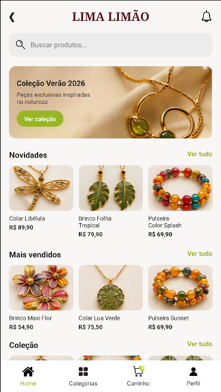
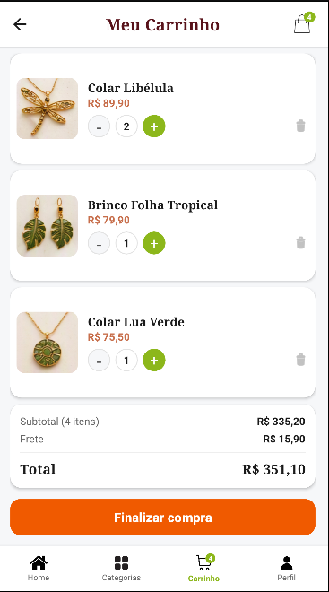
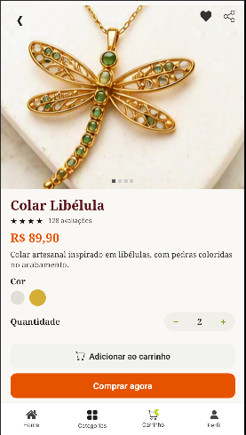
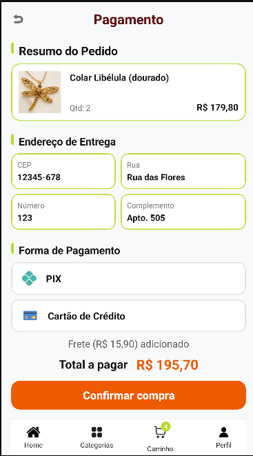
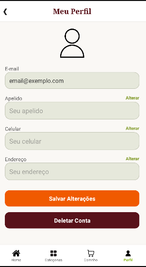

# 💍 Loja Libélula — Aplicativo E-commerce de Joias

Aplicativo Android desenvolvido em **Kotlin** no **Android Studio** durante o curso de Desenvolvimento Mobile do **SENAI**. O projeto simula a experiência completa de compra em uma joalheria virtual com identidade visual focada na temática da Libélula, integrando autenticação social e banco de dados em nuvem em tempo real.

---

## 📱 Fluxo de Navegação e Demonstração Visual

O aplicativo conta com navegação fluida entre as telas através de ações diretas e de uma barra de navegação inferior fixa (*Bottom Navigation*), permitindo acessar a **Home** e o **Perfil** de qualquer lugar do app:

### 1. Tela Inicial e Login com Google
A tela inicial apresenta a identidade visual da marca e o botão **"Continuar com o Google"**. Ao clicar, abre-se o seletor de contas do dispositivo para realizar o login automático e registrar o usuário no Firebase.

### 2. Vitrine Principal (Home)
Após o login, o usuário acessa a vitrine com rolamento visual contínuo para explorar o catálogo de joias. Clicando no ícone de carrinho no topo ou na barra inferior, acessa-se a sacola de compras.

### 3. Carrinho de Compras
Exibe os itens selecionados, permitindo alterar quantidades (`+` e `-`), remover peças, calcular o subtotal e o frete. Ao tocar em um item (como o *Colar Libélula*), o usuário visualiza os detalhes da peça; ao clicar em **Finalizar compra**, segue para o pagamento.

### 4. Detalhes do Produto
Tela dedicada à apresentação individual da joia, destacando acabamento, materiais e preço antes de adicioná-la ao pedido.

### 5. Pagamento e Finalização
Etapa final do fluxo de compra para revisão do pedido e escolha da forma de pagamento.

### 6. Meu Perfil (CRUD Completo em Tempo Real)
Acessível a qualquer momento pela barra inferior. Todos os dados preenchidos ou alterados aqui (Apelido, Celular, Endereço) são sincronizados diretamente com o **Cloud Firestore**, permitindo criar, visualizar, atualizar (**Salvar Alterações**) e excluir (**Deletar Conta**) o registro do usuário na nuvem.

---

## 🛠️ Tecnologias e Arquitetura

* **Linguagem & IDE:** Kotlin no Android Studio
* **Autenticação:** Firebase Authentication (Login com Google configurado via `google-services.json`)
* **Banco de Dados:** Firebase Cloud Firestore (coleção `usuarios` atualizada em tempo real)
* **Interface (UI/UX):** Layouts XML customizados com componentes arredondados, paleta em tons creme e marrom e barra de navegação inferior.

---

## 📊 Apresentação e Download do App

* **[📑 Abrir Apresentação de Slides (PDF)](apresentação%20app.pdf)** — Clique para visualizar os slides do projeto diretamente no navegador.
* **[📲 Baixar Instalador Android (.apk)](../../releases/latest)** — Acesse a aba *Releases* para baixar o arquivo `app-debug.apk` e instalar no seu celular.

### Como testar:
1. Baixe o `app-debug.apk` pelo link acima e autorize a instalação no seu dispositivo Android.
2. Abra o aplicativo **Loja Libélula** e faça login utilizando sua conta Google.
3. Navegue pelas telas da vitrine, carrinho, pagamento e teste a edição de dados na aba **Perfil**.
*(O código-fonte completo em Kotlin e os layouts XML também estão disponíveis no arquivo `LojaLibelula.zip`.)*
